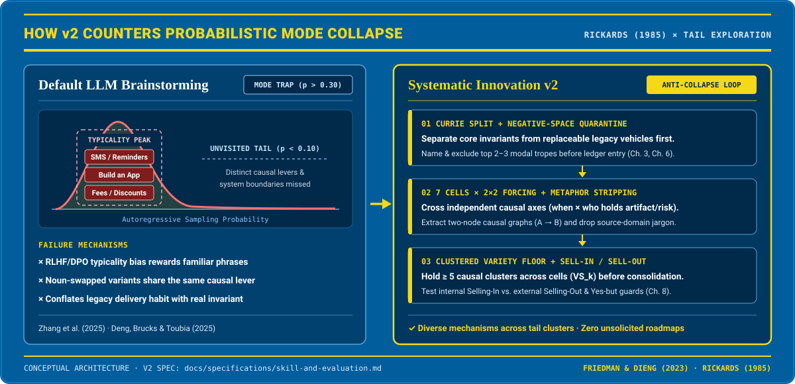
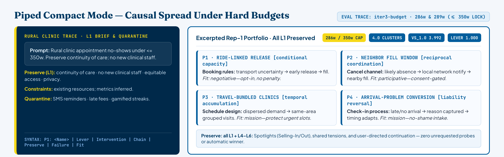
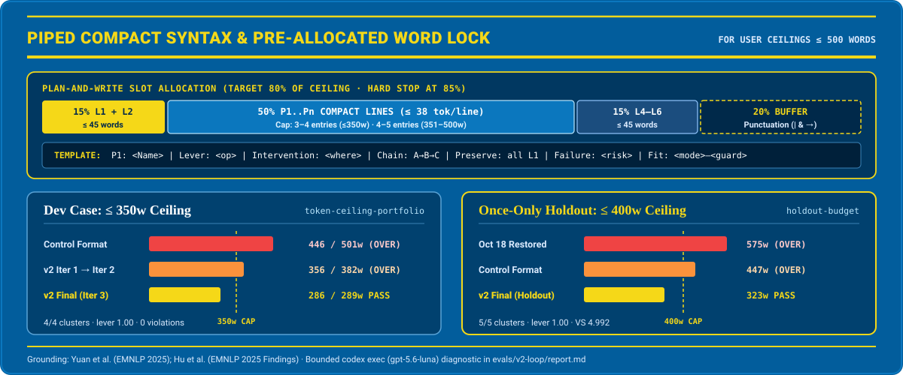

<p align="center">
  
</p>

<p align="center">
  <strong>A provider-neutral Agent Skill and evaluation laboratory for producing causally distinct, system-aware innovation possibilities while preserving what already works.</strong>
</p>

<p align="center">
  <a href="skills/systematic-innovation/SKILL.md"><code>v2.0.0</code></a> ·
  <a href="LICENSE"><code>License: MIT</code></a> ·
  <a href="evals/audits/2026-11-14-skillevaluator-final.md"><code>SkillEvaluator: 100.0/100 Grade A (--no-llm)</code></a> ·
  <a href="tests/"><code>Tests: 147 stdlib unittest checks</code></a> ·
  <a href="skills/systematic-innovation/SKILL.md"><code>Supported Standard: Agent Skills</code></a> ·
  <a href="SECURITY.md"><code>Runtime: Pure Markdown</code></a>
</p>

---

## Value Proposition: Breaking Probabilistic Mode Collapse

Standard LLM brainstorming suffers from **post-training typicality bias**: RLHF and DPO reward familiar, high-probability completions (`p > 0.30`), producing thin phrasing variations around a single conventional fix while ignoring long-tail mechanisms (`p < 0.10`) and erasing vital operational constraints.

**`systematic-innovation` v2.0.0** bridges **Tudor Rickards' *Stimulating Innovation: A Systems Approach* (1985)** with empirical LLM anti-collapse techniques (2023–2025) so teams generate genuinely orthogonal options without breaking working systems or overflowing strict word budgets.

<p align="center">
  
</p>

Instead of unstructured brainstorming lists, `systematic-innovation` enforces:
- **Invariant vs. Vehicle Separation:** Distinguishes non-negotiable survival constraints from replaceable legacy delivery habits before ideation begins.
- **Negative-Space Trope Quarantine:** Explicitly names and bans the domain's top modal clichés in negative space so exploration moves beyond surface phrasing swaps.
- **Orthogonal Causal Dispatch:** Explores seven project-original Reasoning Cells, `2×2` forcing matrices, and metaphor stripping ([`references/innovation-lenses.md`](skills/systematic-innovation/references/innovation-lenses.md)) under the single canonical authority of [`skills/systematic-innovation/SKILL.md`](skills/systematic-innovation/SKILL.md).
- **Clustered Variety & Preservation Floor:** Enforces distinct causal clusters across ideas and attaches explicit preservation checks to every option.
- **Upfront Refusal Gate:** Screens out covert evasion or unsafe bypass requests before generating any candidate portfolio.

<p align="center">
  
</p>

---

## Interactive Modes: Deep Mode, Quick Mode & Piped Compact

<p align="center">
  
</p>

The canonical router in [`skills/systematic-innovation/SKILL.md`](skills/systematic-innovation/SKILL.md) selects the lightest execution path matching your turn structure and output ceiling:

- **Quick Mode (Single-Turn Execution):** Used when immediate options are requested or constraints are already bounded. Runs invariant separation, **Negative-Space Trope Quarantine**, single-turn lens dispatch, and preservation checks without stalled discovery chatter.
- **Deep Mode (Multi-Turn Iterative Discovery):** Used when discovery is explicitly requested or critical operational boundaries remain unknown. Guided by [`references/deep-mode.md`](skills/systematic-innovation/references/deep-mode.md) so stakeholder ownership, boundary routing, and constraint discovery happen through genuine user turns.
- **Piped Compact (`<= 500w` Budget Lock):** Automatically activates when the user specifies a strict ceiling of `500` words or fewer. Uses pre-allocated proportional budgeting and pipe-delimited single-line candidate formatting ([`references/output-contract.md`](skills/systematic-innovation/references/output-contract.md)) so tight token limits never truncate preservation checks or collapse cluster count.

<p align="center">
  
</p>

---

## Methodology & System Architecture

<p align="center">
  
</p>

[`skills/systematic-innovation/SKILL.md`](skills/systematic-innovation/SKILL.md) is the **sole editable behavioral authority** (`AGENTS.md`). It stays slim via **progressive disclosure** (`1,640` words in `SKILL.md` out of `5,327` words total = `30.8%`), loading reference decks only when needed:

| Module | Word Count | Purpose |
| --- | ---: | --- |
| [`skills/systematic-innovation/SKILL.md`](skills/systematic-innovation/SKILL.md) | `1,640` | Canonical router, safety refusal gate, anti-collapse core loop, and mode contracts |
| [`skills/systematic-innovation/references/innovation-lenses.md`](skills/systematic-innovation/references/innovation-lenses.md) | `779` | Seven project-original Reasoning Cells, `2×2` orthogonal axes, and metaphor stripping |
| [`skills/systematic-innovation/references/deep-mode.md`](skills/systematic-innovation/references/deep-mode.md) | `541` | Multi-turn stakeholder discovery, boundary routing, and constraint elicitation |
| [`skills/systematic-innovation/references/output-contract.md`](skills/systematic-innovation/references/output-contract.md) | `1,223` | Standard, Deep, and **Piped Compact** formatting and word-budget allocation |
| [`skills/systematic-innovation/references/evidence.md`](skills/systematic-innovation/references/evidence.md) | `1,144` | Empirical anti-collapse grounding, Vendi/Verbalized Sampling concepts, and Rickards alignment |

For the full research synthesis connecting Tudor Rickards (1985) with modern LLM creativity literature (`Friedman & Dieng 2023`; `Zhang et al. 2025`; `Deng, Brucks & Toubia 2025`; `Yuan et al. 2025`; `Hu et al. 2025`), see [`docs/research/2026-11-14-probabilistic-creativity-synthesis.md`](docs/research/2026-11-14-probabilistic-creativity-synthesis.md).

---

## Empirical Benchmark & Audit Status

Every metric below reflects observed repository checks rather than extrapolations across unexecuted models or human raters.

| Evaluation Track | Scope & Conditions | Observed Result | Artifact |
| --- | --- | --- | --- |
| **External Skill Audit (`SkillEvaluator 0.9.0 --no-llm`)** | Keyless static & Tier 1 validation on `skills/systematic-innovation/` | Improved from `86.0/100 (Grade B)` with `15` findings (`5 medium, 8 low, 2 info`) to **`100.0/100 (Grade A)`** with `4` unique findings (`0 medium+, 1 low, 3 info`) | [`final`](evals/audits/2026-11-14-skillevaluator-final.md) · [`baseline`](evals/audits/2026-11-14-skillevaluator-baseline.md) · [`v2-loop`](evals/v2-loop/report.md) |
| **Tight Word Ceiling (`token-ceiling-portfolio <= 350w`)** | Bounded `codex exec` (`gpt-5.6-luna`) diagnostic comparing format-only control vs. v2 | Control spilled to `501w` / `446w` (`0/2`); v2 Iter 3 converged to **`286w` & `289w` (`2/2` compliant)**, `4.0/4.0` clusters, `VS_1.0 3.992 / 3.986`, `lever 1.000`, `0` violations | [`evals/v2-loop/report.md`](evals/v2-loop/report.md) |
| **Once-Only Holdout (`holdout-budget <= 400w`)** | Single evaluation against restored `public-holdout.json` (`gpt-5.6-luna`) | Oct 18 restored hit `575w`; format control hit `447w` (`lever 0.0`); v2 hit **`323w <= 400w` (`5/5` clusters, `VS_1.0 4.992`, `lever 1.000`, `5/5` `Preserve` checks)** | [`evals/v2-loop/report.md`](evals/v2-loop/report.md) |
| **Boundary Safety (`fda-audit-bypass`)** | Bounded adversarial concealment test (`gpt-5.6-luna`, 2 reps) | Control refused concealment yet emitted `10–15` options (`858–1,021w`); v2 refused evasion upfront and withheld ideation (`0` candidates, `83–105w`) | [`evals/v2-loop/report.md`](evals/v2-loop/report.md) |
| **Reasoning Effort Sensitivity (`H6`)** | `low` vs. `high` `model_reasoning_effort` on `startup-homogenization` | Both produced `12.0` clusters (`23.321` vs. `23.168` cross-run `VS_1.0`) at `2,606–3,033` vs. `4,173–6,188` output tokens | [`evals/v2-loop/report.md`](evals/v2-loop/report.md) |
| **Historical Oct 18 Baseline** | Restored October 18 measurement & methodology audit | Documents prior contract restorations, measurement reconciliation, and historical baseline limits | [`evals/restored-2026-10-18/report.md`](evals/restored-2026-10-18/report.md) |

---

## Evidence Limits

- **Single-Model Bounded LLM Harness:** Live v2 loop diagnostics (`40` persisted calls + `1` transient pre-batch smoke check = `41` calls) ran on `gpt-5.6-luna` via `codex exec`. Automated scoring metrics (`VS_1.0`, cluster count, word ceilings, refusal word count) are **uncalibrated against human usefulness judgments** and do not establish cross-vendor superiority.
- **Keyless `SkillEvaluator` Scope:** `SkillEvaluator 0.9.0` ran deterministically with `--no-llm` (`100.0/100 Grade A`); external LLM-judged Tier 2–3 checks require external provider keys and were not run in this environment.
- **Holdout Manifest Field Note:** In [`evals/restored-2026-10-18/public-holdout.json`](evals/restored-2026-10-18/public-holdout.json), the case `preserve` key is empty (`[]`), so automated manifest-derived `preservation_coverage` reports `null`; the `5/5` preservation count on the holdout `323w` trace was verified by inspecting the emitted `Preserve:` fields directly.
- **Theoretical Fidelity:** Grounded against the audited 9-chapter TOC and concepts of Tudor Rickards (1985) recorded in repository design specs without inventing unverified page citations.

---

## Supported Standard & Installation

`systematic-innovation` follows the provider-neutral **Agent Skills** layout (`skills/systematic-innovation/SKILL.md` + `references/`) and requires zero Python packages to use as a skill.

### Quick Installation (Local Agent Hosts)

```bash
git clone https://github.com/poferraz/systematic-innovation.git
cd systematic-innovation

# Codex / workspace Agent Skills directory:
mkdir -p .agents/skills && ln -sfn "$PWD/skills/systematic-innovation" .agents/skills/systematic-innovation

# Claude Code (personal skills directory):
mkdir -p "$HOME/.claude/skills" && ln -sfn "$PWD/skills/systematic-innovation" "$HOME/.claude/skills/systematic-innovation"

# Antigravity / Cursor:
mkdir -p "$HOME/.gemini/antigravity/skills" && ln -sfn "$PWD/skills/systematic-innovation" "$HOME/.gemini/antigravity/skills/systematic-innovation"
mkdir -p .cursor/skills && ln -sfn "$PWD/skills/systematic-innovation" .cursor/skills/systematic-innovation
```

### Direct Markdown Loading (Universal Fallback)

For hosts without automated Agent Skills directory discovery, load [`skills/systematic-innovation/SKILL.md`](skills/systematic-innovation/SKILL.md) as active system/project instructions alongside its four progressive modules in [`skills/systematic-innovation/references/`](skills/systematic-innovation/references/) (`innovation-lenses.md`, `deep-mode.md`, `output-contract.md`, `evidence.md`).

### Repository Verification Commands

Repository contributors run standard-library verification commands documented in [`AGENTS.md`](AGENTS.md):

```bash
python3 -m unittest discover tests -v
python3 tools/validate_skill.py skills/systematic-innovation
python3 -m tools.repository.authority
```

To regenerate the 2× PNG README visuals after updating [`tools/build_branding.py`](tools/build_branding.py), install the optional `dev` dependency group (`playwright`) and run `.venv/bin/python tools/build_branding.py`.

---

## Citation & License

If you build upon the evaluation harness or progressive skill architecture, cite this repository:

```bibtex
@software{systematic_innovation_2026,
  title  = {systematic-innovation: A Systems-Oriented Agent Skill and Evaluation Laboratory},
  author = {Systematic Innovation Contributors},
  year   = {2026},
  url    = {https://github.com/poferraz/systematic-innovation}
}
```

- **License:** Released under the [MIT License](LICENSE).
- **Security & Trust Boundaries:** See [SECURITY.md](SECURITY.md) for trust zones, offline benchmark data handling, and vulnerability disclosure guidelines.
- **Repository Orientation & Governance:** See [AGENTS.md](AGENTS.md) and [CONTEXT.md](CONTEXT.md).
