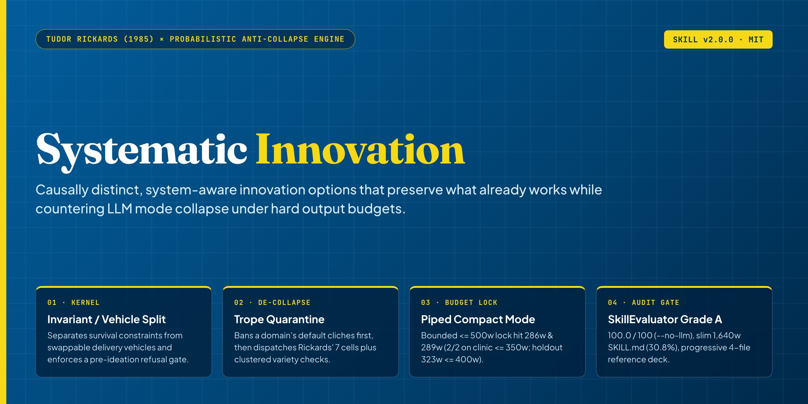
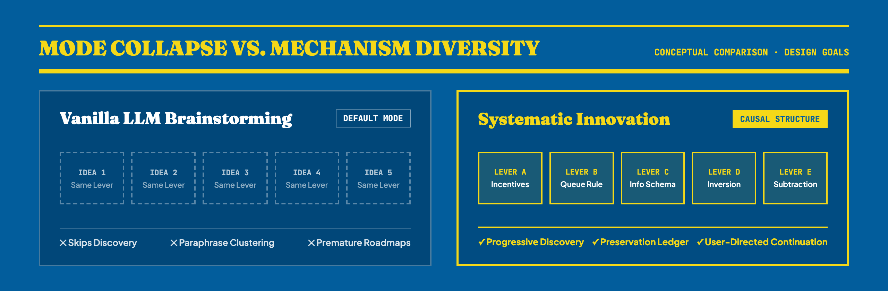
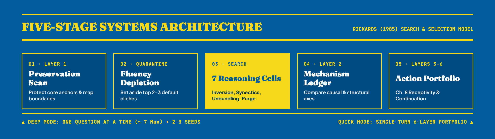

<p align="center">
  
</p>

<p align="center">
  <strong>A provider-neutral Agent Skill and evaluation laboratory for causally distinct, system-aware innovation possibilities.</strong>
</p>

<p align="center">
  <a href="LICENSE"></a>
  <a href="skills/systematic-innovation/SKILL.md"></a>
  <a href="evals/stress/five-cycle-report.md"></a>
  <a href="tests/"></a>
  <a href="SECURITY.md"></a>
</p>

---

## Value Proposition: Beyond Brainstorming Cliches

Ordinary brainstorming can produce familiar variations, miss system constraints, or jump prematurely to implementation. This skill provides a structured way to explore different mechanisms while preserving existing value.

**`systematic-innovation`** transforms ordinary AI ideation through socio-technical systems theory (Tudor Rickards, *Stimulating Innovation: A Systems Approach*, 1985) and modern empirical LLM ideation science (2024–2026).

<p align="center">
  
</p>

Instead of generic solution dumps, `systematic-innovation` delivers:
- **Initial Fluency Depletion:** Identifies and explicitly quarantines the top-of-mind memory-dump tropes before populating candidates.
- **Mechanism Ledger:** Records structural coordinates to support mechanism-level duplicate checks; the [canonical skill](skills/systematic-innovation/SKILL.md) defines the current fields.
- **Preservation Inventory:** Explicitly maps non-negotiables and core operational strengths that must not be disrupted.
- **Problem-Owner Receptivity:** Evaluates Rickards's 3 Problem-Owner Questions, boundary overflow routing (Mission-Orientated / Negotiative / Participative), and *Yes-But* hearing inoculation.
- **Decision Restraint:** Keeps the portfolio open for user-directed comparison and continuation.

---

## Interactive Walkthrough & Quick Demos

<p align="center">
  
</p>

### Deep Mode (Multi-Turn Iterative Discovery)
For example: “Help our regional library explore access options. Ask me about the constraints before synthesizing a portfolio.”

Discovery depends on an actual opportunity for user replies. The [canonical router](skills/systematic-innovation/SKILL.md) and [Deep reference](skills/systematic-innovation/references/deep-mode.md) define current behavior. The [contract findings](evals/stress/contract-findings.md) identify differences that still need reconciliation with the approved specification.

### Quick Mode (Single-Turn Execution)
For example: “Give me a complete portfolio now for reducing household food waste, using the constraints above.”

The canonical router defines single-turn precedence, explicit overrides, and budget handling. This README does not maintain separate candidate-count or question-count rules.

---

## The Systematic Innovation Pipeline

<p align="center">
  
</p>

### Methodology

The skill combines reframing, system and preservation awareness, contrasting reasoning transformations, and mechanism tracking. The illustrations are conceptual, not a behavioral contract or evidence of measured superiority.

The exact workflow and output rules live only in the [canonical skill](skills/systematic-innovation/SKILL.md), [innovation lenses](skills/systematic-innovation/references/innovation-lenses.md), and [output contract](skills/systematic-innovation/references/output-contract.md). See the [evidence reference](skills/systematic-innovation/references/evidence.md) for attribution boundaries.

---

## Empirical Benchmark Status

The repository retains a 12-case pilot and a public adversarial stress corpus. Current results are exploratory development evidence, documented in the [five-cycle report](evals/stress/five-cycle-report.md).

The earlier pilot's **+162% causal-density and per-token efficiency headlines are withdrawn as substantiated performance claims**. Recovery exposed regex token estimates, discovery-only outputs counted as portfolios, lexical clustering errors, and missing calibrated mechanism-quality judgments. These numbers do not establish the approved qualified-useful-mechanism primary endpoint.

Current evidence covers sampled output behavior, structural diagnostics, and explicitly audited token accounting. No calibrated judge or human evaluation has been performed; format-matched and established-method comparisons, primary-effect validation, broad host compatibility, and release eligibility remain unverified. The [contract findings](evals/stress/contract-findings.md) also identify discrepancies between the recovered skill and the approved specification.

The [original treatment analysis](evals/pilot/treatment-analysis.md) and [candidate assessment](evals/pilot/candidate-report.md) remain available as superseded historical records, together with unchanged raw responses.

---

## Supported Standard & Installation

`systematic-innovation` adheres strictly to the **Agent Skills Specification**:
- **100% Portable Markdown:** Operates inside system prompts and context windows.
- **Zero Binary Dependencies:** Zero Python or native library dependencies at runtime.
- **Offline Capability:** The core requires no network access; host tools and their network behavior are configured separately.

### Local Installation

Clone the repository and validate package integrity:

```bash
git clone https://github.com/poferraz/systematic-innovation.git
cd systematic-innovation

# Run the deterministic package validator
python tools/validate_skill.py skills/systematic-innovation
```

To install into your local agent environment:

```bash
# Antigravity / Gemini CLI
cp -r skills/systematic-innovation ~/.gemini/antigravity/skills/

# Claude Desktop / Claude Code
cp -r skills/systematic-innovation ~/.claude/skills/

# Codex / OpenAI CLI
cp -r skills/systematic-innovation ~/.codex/skills/

# Cursor
cp -r skills/systematic-innovation .cursor/skills/
```

### Direct Markdown Loading (Universal Fallback)
If your environment does not support automated skill discovery, pass [`skills/systematic-innovation/SKILL.md`](skills/systematic-innovation/SKILL.md) directly into your agent's context window or system prompt.

---

## Evidence Limits & Bibliographic Record

This repository enforces strict provenance boundaries:
- **Verified Primary Source:** Tudor Rickards (1985), *Stimulating Innovation: A Systems Approach*, Frances Pinter (Publishers), London, `pp. xi + 221`, ISBN `0-86187-512-5`.
- **Verified Contents:** The nine-chapter bibliographic record and the exclusions for unverified reconstructions are maintained in the canonical [evidence reference](skills/systematic-innovation/references/evidence.md).
- **Provenance Boundaries:** The canonical [evidence reference](skills/systematic-innovation/references/evidence.md) distinguishes primary-source principles, adaptations, and AI mechanisms. The [contract findings](evals/stress/contract-findings.md) identify classifications that still require reconciliation with the approved specification.

---

## Academic Citation

If you use `systematic-innovation` in your research, evaluations, or agentic systems:

```bibtex
@software{systematic_innovation_2026,
  author = {Systematic Innovation Contributors},
  title = {Systematic Innovation: A Systems Approach to LLM Ideation and Possibility Exploration},
  year = {2026},
  url = {https://github.com/poferraz/systematic-innovation},
  license = {MIT}
}
```

---

## License & Security

- **License:** [MIT License](LICENSE)
- **Security & Responsible Use:** See [SECURITY.md](SECURITY.md) for vulnerability reporting guidelines and safe prompt isolation instructions.
