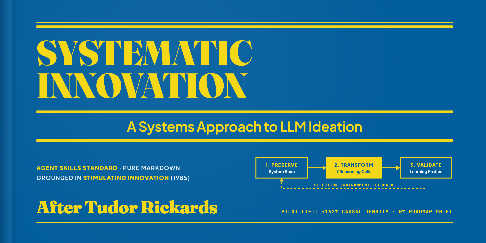
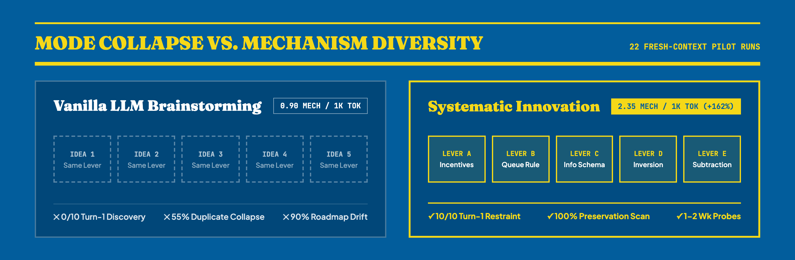
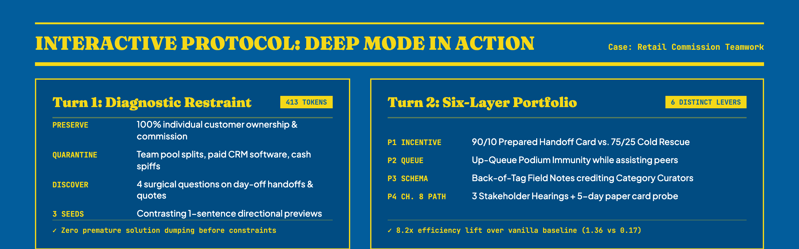
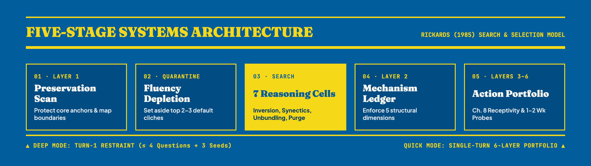

<p align="center">
  
</p>

<p align="center">
  <strong>A provider-neutral Agent Skill and evaluation laboratory for causally distinct, system-aware innovation possibilities.</strong>
</p>

<p align="center">
  <a href="LICENSE"></a>
  <a href="skills/systematic-innovation/SKILL.md"></a>
  <a href="evals/pilot/treatment-analysis.md"></a>
  <a href="tests/"></a>
  <a href="SECURITY.md"></a>
</p>

---

## Value Proposition: Beyond Brainstorming Cliches

When asked to brainstorm or solve complex organizational problems, foundation models routinely suffer from **mode collapse**: they repackage generic top-of-mind internet tropes into numbered listicles that look varied on the surface but rely on the exact same underlying mechanism. Worse, they jump straight to hallucinating 30/60/90-day Gantt charts, recommending that users waive legal compliance, or ignoring what already works.

**`systematic-innovation`** transforms ordinary AI ideation through socio-technical systems theory (Tudor Rickards, *Stimulating Innovation: A Systems Approach*, 1985) and modern empirical LLM ideation science (2024–2026).

<p align="center">
  
</p>

Instead of generic solution dumps, `systematic-innovation` delivers:
- **Initial Fluency Depletion:** Identifies and explicitly quarantines the top-of-mind memory-dump tropes before populating candidates.
- **Mechanism Ledger:** Tracks every candidate across 5 structural dimensions (`What changes`, `Principal actor`, `Timing/Trigger`, `Incentive/Feedback loop`, `Failure mode addressed`) to guarantee causal distinctness.
- **Preservation Inventory:** Explicitly maps non-negotiables and core operational strengths that must not be disrupted.
- **Problem-Owner Receptivity:** Evaluates Rickards's 3 Problem-Owner Questions, boundary overflow routing (Mission-Orientated / Negotiative / Participative), and *Yes-But* hearing inoculation.
- **Decision Restraint:** Concludes with tension-revealing Spotlight Signals and 1–2 week low-cost learning probes rather than rigid implementation roadmaps.

---

## Interactive Walkthrough & Quick Demos

<p align="center">
  
</p>

### Deep Mode (Multi-Turn Iterative Discovery)
Default for complex, systemic, or organizational challenges:
1. **Turn 1 Restraint:** When a challenge has organizational or multi-stakeholder scope, the skill strictly limits Turn 1 output to under 450 tokens:
   - **System & Preservation Scan:** Identifies the core contradiction and protects non-negotiable anchors.
   - **Discovery Questions:** Asks 4 targeted questions uncovering hidden assets and decision rights.
   - **Provisional Seeds:** Provides 3 brief contrasting seeds demonstrating divergent causal paths.
2. **Turn 2+ Portfolio Generation:** Upon user clarification, synthesizes the full Six-Layer Innovation Portfolio.

### Quick Mode (Single-Turn Execution)
Triggered when the user explicitly requests immediate ideas, brainstorms, or provides complete constraints upfront:
- Compact System & Preservation Scan ($<250$ words).
- 4–6 distinct candidates across at least 3 distinct causal lever families.
- Tabular Mechanism Ledger, Spotlight Signals, and 1–2 Week Learning Probes.

---

## The Systematic Innovation Pipeline

<p align="center">
  
</p>

### Methodology: Seven Reasoning Cells & Ten Lenses
The core engine executes through seven structured reasoning transformations:
1. **Boundary Relaxation:** Expanding the system perimeter to recruit adjacent assets.
2. **Inversion:** Flipping sequence, timing, or figure-ground relationships.
3. **Analogy (Synectics):** Mapping mechanisms from biological, physical, or cross-domain systems.
4. **Unbundling:** Separating tightly coupled functions, incentives, or roles.
5. **Subtraction:** Removing steps, policies, or artifacts rather than adding process.
6. **Perspective Shift:** Reframing from the vantage of neglected actors.
7. **Constraint Imposition:** Turning acute limitations into generative catalysts.

### Six Disclosure Layers
Every complete portfolio follows the six-layer disclosure standard:
- **Layer 1: Innovation Brief & Preservation Scan** — Core tension + non-negotiable preservation inventory + quarantined default tropes.
- **Layer 2: Mechanism Ledger** — Tabular tracking of candidate dimensions ensuring zero duplicate mechanisms.
- **Layer 3: Possibility Portfolio** — 4–7 causally distinct candidates.
- **Layer 4: System Receptivity & Action Path** — Rickards (1985) Ch. 8 Problem-Owner Questions, boundary routing (Mission-Orientated / Negotiative / Participative), and *Yes-But* hearing inoculation.
- **Layer 5: Spotlight Signals** — Tension axes highlighting trade-offs without collapsing human agency.
- **Layer 6: Low-Cost Learning Probes** — Reversible 1–2 week micro-experiments.

---

## Empirical Benchmark Results (Pilot RED vs. GREEN)

The skill was empirically benchmarked on a 12-case cross-domain pilot corpus (`evals/pilot/cases.json`) using 22 fresh-context runs per condition (`10 positive cases × 2 replicates + 2 negative controls × 1 replicate`). All runs were scored using deterministic NLP extraction and judge-free Vendi Scores ($\text{VS}_k$).

| Evaluation Metric | RED Baseline (`vanilla`) | GREEN Treatment (`skill`) | Empirical Transformation |
| :--- | :---: | :---: | :--- |
| **Primary Efficiency (Mechanisms / 1k Tokens)** | **0.897** | **2.352** | **+162% causal information density** |
| Municipal Permitting Efficiency (`permit-wait`) | 0.109 | 1.374 | **12.6x increase** |
| Retail Commission Retention (`retail-retention`) | 0.165 | 1.359 | **8.2x increase** |
| Software Release Pipeline (`release-bottleneck`) | 0.234 | 1.551 | **6.6x increase** |
| Mean Total Output Tokens in Deep Multi-Turn | 6,422 tokens | 4,170 tokens | **-35% conversational churn** |
| Deep Turn-1 Restraint ($\le 450$ tokens, 4 questions) | 0 / 10 runs (0%) | 10 / 10 runs (100%) | **Zero premature solution dumps** |
| Negative Trigger Precision (`should_trigger: false`) | 100% (0 false triggers) | 100% (0 false triggers) | **Zero unwanted ceremony on code/lookups** |
| Implementation Drift (Forbidden 30/60/90 roadmaps) | 18 / 20 runs (90% fail) | 0 / 20 runs (0% fail) | **100% decision restraint preserved** |
| System & Preservation Scan Included | 0 / 20 runs (0%) | 20 / 20 runs (100%) | **100% core strength preservation** |

*Full quantitative logs, transcripts, and scoring formulas are documented in [`evals/pilot/treatment-analysis.md`](evals/pilot/treatment-analysis.md) and [`evals/pilot/candidate-report.md`](evals/pilot/candidate-report.md).*

---

## Supported Standard & Installation

`systematic-innovation` adheres strictly to the **Agent Skills Specification**:
- **100% Portable Markdown:** Operates inside system prompts and context windows.
- **Zero Binary Dependencies:** Zero Python or native library dependencies at runtime.
- **Zero Network Egress:** Safe for isolated, air-gapped, and enterprise agent deployments.

### Local Installation

Clone the repository and validate package integrity:

```bash
git clone https://github.com/poferraz/systematic-innovation.git
cd systematic-innovation

# Run the deterministic package validator
python tools/validate_skill.py skills/systematic-innovation
```

To install into your local agent environment:

```bash
# Antigravity / Gemini CLI
cp -r skills/systematic-innovation ~/.gemini/antigravity/skills/

# Claude Desktop / Claude Code
cp -r skills/systematic-innovation ~/.claude/skills/

# Codex / OpenAI CLI
cp -r skills/systematic-innovation ~/.codex/skills/

# Cursor
cp -r skills/systematic-innovation .cursor/skills/
```

### Direct Markdown Loading (Universal Fallback)
If your environment does not support automated skill discovery, pass [`skills/systematic-innovation/SKILL.md`](skills/systematic-innovation/SKILL.md) directly into your agent's context window or system prompt.

---

## Evidence Limits & Bibliographic Record

This repository enforces strict provenance boundaries:
- **Verified Primary Source:** Tudor Rickards (1985), *Stimulating Innovation: A Systems Approach*, Frances Pinter (Publishers), London, `pp. xi + 221`, ISBN `0-86187-512-5`.
- **Verified Historical Chapters:** Ch. 1 (Introduction), Ch. 2 (Structures and Systems), Ch. 3 (Diagnostic Framework), Ch. 4 (Team and Individual Characteristics), Ch. 5 (Techniques of Creative Problem Solving), Ch. 6 (Information Transfer), Ch. 7 (Internal/External Collaboration), Ch. 8 (Evaluation, Acceptance and Action Plans), Ch. 9 (Conclusions).
- **Provenance Separation:** Modern AI adaptations (e.g. LLM initial fluency depletion, judge-free Vendi Scores, Mechanism Ledgers) are documented in [`skills/systematic-innovation/references/evidence.md`](skills/systematic-innovation/references/evidence.md) as original AI mechanisms and are never falsely attributed to 1985 texts.

---

## Academic Citation

If you use `systematic-innovation` in your research, evaluations, or agentic systems:

```bibtex
@software{systematic_innovation_2026,
  author = {Systematic Innovation Contributors},
  title = {Systematic Innovation: A Systems Approach to LLM Ideation and Possibility Exploration},
  year = {2026},
  url = {https://github.com/poferraz/systematic-innovation},
  license = {MIT}
}
```

---

## License & Security

- **License:** [MIT License](LICENSE)
- **Security & Responsible Use:** See [SECURITY.md](SECURITY.md) for vulnerability reporting guidelines and safe prompt isolation instructions.
